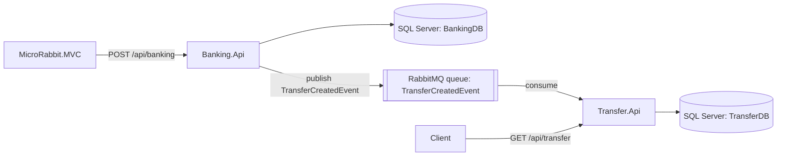

# Architecture — MicroRabbit

Reference doc for AI coding loops working in this repo: two .NET 8
microservices (Banking and Transfer) that communicate through a **hand-written
event bus on RabbitMQ** (`RabbitMQ.Client`, no MassTransit), plus an ASP.NET Core
MVC client. Commands go through MediatR inside a service; events cross services
through the bus. This map summarises the structure so an agent can find its way
around without re-reading every source file.

All paths are relative to the repo root.

## System summary

| Component | Projects | Role | Store |
|---|---|---|---|
| Banking service | `MicroRabbit.Banking.{Api,Application,Domain,Data}` | Lists accounts; accepts a transfer request and publishes `TransferCreatedEvent` | SQL Server `BankingDB` (`Accounts`) |
| Transfer service | `MicroRabbit.Transfer.{Api,Application,Domain,Data}` | Subscribes to `TransferCreatedEvent` and records a `TransferLog`; lists the logs | SQL Server `TransferDB` (`TransferLogs`) |
| MVC client | `MicroRabbit.MVC` | A form that posts a transfer to the Banking API over HTTP | none |

Shared projects:

| Project | Purpose |
|---|---|
| `MicroRabbit.Domain` | The bus abstractions: `IEventBus`, `IEventHandler<TEvent>`, `Message` (a MediatR `IRequest<bool>` with `MessageType`), `Command : Message`, `Event` (with `Timestamp`) |
| `MicroRabbit.Infra.Bus` | `RabbitMQBus`, the `IEventBus` implementation (RabbitMQ.Client 6.8, Newtonsoft.Json, MediatR) |
| `MicroRabbit.Infra.IoC` | `DependencyContainer.RegisterServices(services)`: DI registrations for the bus, handlers, application services, repositories and DbContexts **of both services** |

Solution: `MicroRabbit.sln` (12 projects, all `net8.0`).

## System diagram



## Layering (per service)

```
*.Api          controllers, Program.cs (wiring, Swagger)
  → *.Application   application services (IAccountService, ITransferService) and request models
    → *.Domain      commands, command handlers, events, event handlers, entities, repository interfaces
  → *.Data          EF Core DbContext, repositories, migrations
Infra.IoC references every layer of both services and is referenced by both APIs.
```

## Request flow: a transfer

```
MVC HomeController.Transfer (form post)
  → TransferService (typed HttpClient) POST {BankingUrl}/api/banking
Banking.Api BankingController.Post(AccountTransfer)
  → IAccountService.Transfer → new CreateTransferCommand(from, to, amount)
  → IEventBus.SendCommand(command) → IMediator.Send
  → TransferCommandHandler.Handle → IEventBus.Publish(new TransferCreatedEvent(from, to, amount))
  → RabbitMQ queue "TransferCreatedEvent"
Transfer.Api RabbitMQBus consumer
  → new DI scope → resolve TransferEventHandler
  → IEventHandler<TransferCreatedEvent>.Handler(event)
  → ITransferRepository.Add(new TransferLog { ... }) → SaveChanges → TransferDB
```

Banking only publishes the event: **account balances aren't changed** anywhere.

## The event bus (`MicroRabbit.Infra.Bus/RabbitMQBus.cs`)

Registered as a **singleton** `IEventBus`, built with `IMediator` and `IServiceScopeFactory`.

| Method | What it does |
|---|---|
| `SendCommand<T>(command)` | `mediator.Send(command)`: in-process, through MediatR |
| `Publish<T>(event)` | Opens a connection and channel, declares a queue named after the event's class (`event.GetType().Name`), serialises the event with Newtonsoft.Json, and publishes it to the default exchange with the queue name as routing key. The connection is disposed after each publish |
| `Subscribe<T, TH>()` | Records the event type and handler type in in-memory registries (`eventTypes`, `handlers[eventName]`), then starts a consumer |

Consuming (`StartBasicConsume<T>` → `OnReceivedConsumer` → `ProcessEvent`):

1. A long-lived connection with `DispatchConsumersAsync = true` and an `AsyncEventingBasicConsumer` on the event's queue, with **auto-ack**.
2. For each message, the routing key gives the event name. In a new DI scope, each
   registered handler type is resolved, the JSON is deserialised to the event type,
   and `IEventHandler<T>.Handler` is invoked by reflection
   (`typeof(IEventHandler<>).MakeGenericType(eventType)`).
3. Exceptions are caught and ignored.

**The contract is matched by class name.** Banking and Transfer each define their
own `TransferCreatedEvent` (`Banking.Domain/Events`, `Transfer.Domain/Events`) with
the same name and properties. The queue name links them; there's no shared
contracts package.

Subscriptions are set up in `MicroRabbit.Transfer.Api/Program.cs` (`ConfigureEventBus`):
`eventBus.Subscribe<TransferCreatedEvent, TransferEventHandler>()`, before `app.Run()`.

## Commands and MediatR

- `Message : IRequest<bool>`, so every `Command` is a MediatR request returning `bool`.
- Each API calls `AddMediatR(RegisterServicesFromAssembly(typeof(Program).Assembly))`,
  which scans only the API project. `TransferCommandHandler` lives in
  `Banking.Domain`, so it's registered by hand in `DependencyContainer`
  (`IRequestHandler<CreateTransferCommand, bool>`).
- Commands carry `Timestamp`, set in the base constructor; properties have protected setters.

## Data layer

- EF Core with SQL Server, one database per service. `BankingDbContext` has
  `Accounts` (`Id`, `AccountType`, `AccountBalance`); `TransferDbContext` has
  `TransferLogs` (`Id`, `FromAccount`, `ToAccount`, `TransferAmount`).
- Migrations: one `Initial Migration` each, in `*.Data/Migrations`. They aren't
  applied at startup; run `dotnet ef database update` per service. There's no seed
  data, so accounts have to be inserted by hand.
- Repositories are thin: `AccountRepository.GetAccounts()` returns the `DbSet`;
  `TransferRepository.Add(...)` saves synchronously (`SaveChanges`).
- Each API registers its DbContext with `AddDbContext` in `Program.cs`, and
  `DependencyContainer` also registers both DbContexts as transient.

## HTTP endpoints

| Service | Method | Route | Action |
|---|---|---|---|
| Banking | GET | `/api/banking` | List accounts |
| Banking | POST | `/api/banking` | Request a transfer (`AccountTransfer`: `FromAccount`, `ToAccount`, `TransferAmount`); returns 200 with the request body |
| Transfer | GET | `/api/transfer` | List transfer logs |
| MVC | POST | `/home/transfer` | Form post → Banking API |

Swagger is on in every environment for both APIs (`/swagger`).

## Cross-cutting

- **AuthN / AuthZ:** none.
- **Validation:** none (no validators, no model rules beyond binding).
- **Error handling:** no exception handler in the APIs; the MVC client calls
  `EnsureSuccessStatusCode()` and uses `/Home/Error` outside Development.
- **Health checks, logging, tracing:** no health endpoints; `ILogger` is injected but barely used.
- **Tests:** none.

## Runtime / deployment

No Docker Compose or Dockerfiles (only a `.dockerignore`). Everything runs on the host:

| Component | How | Address |
|---|---|---|
| RabbitMQ | Installed locally (hardcoded `HostName = "localhost"`, default port 5672, default credentials) | `localhost:5672` |
| SQL Server | Local instance, Windows authentication | `OSHRAMKO-MBL` (machine name in the connection strings) |
| Banking.Api | `launchSettings.json` | http 5275, https 7075 |
| Transfer.Api | `launchSettings.json` | http 5203, https 7255 |
| MVC | `launchSettings.json` | see the file |

Start order: RabbitMQ and SQL Server, then Transfer.Api (so its consumer declares
the queue), Banking.Api, then the MVC client. In Visual Studio, use "Multiple
startup projects".

## Configuration

```json
// Banking.Api / Transfer.Api appsettings.json
{ "ConnectionStrings": { "BankingDbConnection": "Server=OSHRAMKO-MBL;Database=BankingDB;Trusted_Connection=True;TrustServerCertificate=True;MultipleActiveResultSets=True" } }
{ "ConnectionStrings": { "TransferDbConnection": "Server=OSHRAMKO-MBL;Database=TransferDB;..." } }
// MVC appsettings.json
{ "AppSettings": { "BankingUrl": "https://localhost:7075" } }
```

- The MVC client binds `AppSettings` with `services.Configure<AppSettings>(...)` and reads it through `IOptionsSnapshot`.
- The RabbitMQ host isn't configurable: it's hardcoded in `RabbitMQBus`.

## Known gaps

Found by reading the code; not runtime-tested.

| Area | Gap | Where |
|---|---|---|
| Reliability | Auto-ack plus an empty `catch`: a message whose handler fails is acknowledged and lost. Manual ack/nack with a dead-letter queue would fix it | `RabbitMQBus.StartBasicConsume`, `OnReceivedConsumer` |
| Reliability | Queues are non-durable and messages aren't persistent, so they don't survive a broker restart | `QueueDeclare(eventName, false, false, false, null)`, `BasicPublish(..., null, ...)` |
| Reliability | `AccountService.Transfer` doesn't await `SendCommand`, so the API returns 200 before the event is published, and errors are lost | `Banking.Application/Services/AccountService.cs` |
| Configuration | The RabbitMQ host is hardcoded to `localhost`; SQL Server connection strings use a machine name | `RabbitMQBus`, both `appsettings.json` |
| Performance | A new connection and channel per publish; one long-lived connection is the usual practice | `RabbitMQBus.Publish` |
| Correctness | The duplicate-handler check compares `x.GetType()` (always `RuntimeType`) with the handler type, so it never fires | `RabbitMQBus.Subscribe` |
| Contract | The event is matched by class name only, and each service has its own copy. Renaming either breaks delivery silently | `Banking.Domain/Events`, `Transfer.Domain/Events` |
| Domain | A transfer doesn't debit or credit any account | `TransferCommandHandler`, `TransferEventHandler` |
| Coupling | `Infra.IoC` references both services, so each API registers the other's services, repositories and DbContext | `MicroRabbit.Infra.IoC/DependencyContainer.cs` |
| Lifecycle | The consumer's connection and channel are never disposed or closed on shutdown | `RabbitMQBus.StartBasicConsume` |
| Leftovers | `Banking.Api.http` calls `/weatherforecast/`, which doesn't exist | `MicroRabbit.Banking.Api/MicroRabbit.Banking.Api.http` |

## Repository structure map

| Area | Holds |
|---|---|
| `MicroRabbit.Domain/` | Shared bus abstractions and base message types |
| `MicroRabbit.Infra.Bus/` | The RabbitMQ event bus |
| `MicroRabbit.Infra.IoC/` | DI wiring for both services |
| `MicroRabbit.Banking.*/` | Banking service: API, application, domain, data |
| `MicroRabbit.Transfer.*/` | Transfer service: API, application, domain, data |
| `MicroRabbit.MVC/` | MVC client (form → Banking API) |
| repo root | `MicroRabbit.sln`, `README.md`, `.dockerignore` |
